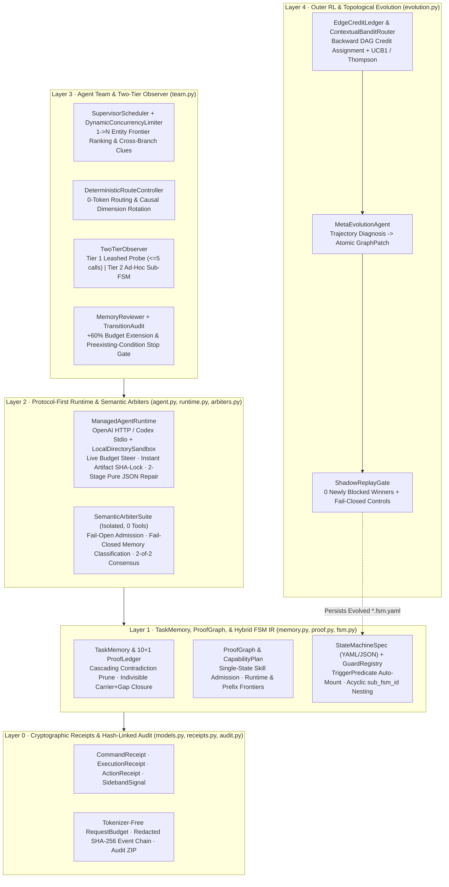

# Vouchloom

**Receipt-Gated Hierarchical State Machines, Agent Team Orchestration, Leashed Observer Breakouts, and Self-Evolving Graph RL.**

`vouchloom` (*Vouch* = cryptographic evidence & receipts; *Loom* = weaving composable state machines) is a general-purpose Python 3.12+ foundation library for long-horizon, high-reliability autonomous agents.

Unlike chat-centric multi-agent frameworks where LLMs freely improvise global control flow and accumulate hallucinations over long contexts, **Vouchloom strictly separates deterministic control from local exploration**:

- **Core Owns State & Receipts**: State transitions, route branching (`new | continue | fork | reopen`), `1 -> N` dynamic entity fission, SHA-256 deduplication, budget envelopes, and final verification are owned exclusively by deterministic Python code.
- **Workers Own Bounded Local Exploration**: Ephemeral Worker sub-agents execute in isolated scratch sandboxes with zero state-mutating business tools, physically branch-locked JSON output schemas, and hard token/tool-call ceilings.
- **No Receipt, No Fact; No Proof Closure, No Transition**: Every discovered child entity, durable memory claim, and out-of-band observer signal must bind a cryptographic `CommandReceipt` or `ExecutionReceipt` before Core admits it.
- **Outer-Loop RL Over Declarative YAML**: An outer `MetaEvolutionAgent` and `ContextualBanditRouter` continuously refine declarative `StateMachineSpec` YAML files in simulation/benchmark environments, gated by `ShadowReplayGate` so historical winning trajectories never regress.

---

## Architecture Overview



---

## Core Design Invariants

| Invariant | Mechanism | Module |
| :--- | :--- | :--- |
| **Strict Schema Boundary** | Every internal and LLM-facing model inherits `StrictModel (extra="forbid")`. Delivery stages use `WorkerArtifactOnlyOutput` (no handoff branch); Core-action/probe stages use `WorkerHandoffOnlyOutput` (no artifact branch). | `models.py`, `agent.py` |
| **Receipt-Bound `1 -> N` Fission** | Any Worker-discovered child `TaskMemoryEntity` or `SidebandSignal` must reference a valid `CommandReceipt.sha256` from that turn; hallucinated entities are dropped. | `memory.py`, `receipts.py` |
| **`10 + 1` Acyclic Proof Ledger** | Each route retains at most `10` regular proof cells + `1` reserved `core.runtime-target.*` slot. Contradicting or rewriting an upstream structural cell cascades to delete all transitive downstream dependents and retires the route. | `memory.py` |
| **Single-State Skill Admission** | `CapabilityPlan` projects current anchor, proof ledger, and execution receipts into a `ProofGraph` and enforces that one Worker turn installs skills from **at most one** capability stage (`analysis`, `construction`, or `runtime`). | `proof.py` |
| **Startup vs. Runtime Verification** | `ExecutionReceipt` separates `environment_startup` noise from `target_runtime` consumption; first milestone hits trigger a `1.2x` verification window and require fresh replay fingerprint agreement. | `receipts.py`, `team.py` |
| **Two-Stage JSON Repair & Salvage** | Schema validation failures retry in-thread first, then escalate to an isolated, tool-free `64k` **Pure JSON Repair Agent**; 1-command wall-clock timeouts salvage receipts via `recover_bounded_action_receipt`. | `runtime.py`, `arbiters.py` |
| **Two-Tier Leashed Observer** | Wakes only on verified `SidebandSignal` or route stall (`stall_count >= K`). Dispatches either a **Tier 1 Leashed Probe** (`<=5` tool calls) or a statically verified **Tier 2 Ephemeral Sub-FSM**. | `team.py` |
| **Non-Regressing Graph Evolution** | `EdgeCreditLedger` assigns backward causal credit along `depends_on` & `cross_entity_refs` DAGs; `ShadowReplayGate` blocks any `GraphPatch` that breaks a historical winner or weakens a fail-closed control. | `evolution.py` |

---

## Installation

Requires **Python 3.12+** and [`uv`](https://docs.astral.sh/uv/):

```bash
git clone git@github.com:EBWi11/Vouchloom.git
cd Vouchloom
uv sync --group dev
```

---

## Quick Start

### 1. Author Composable Micro-FSMs (YAML or Python) and Run an Agent Team

```python
import asyncio
from pathlib import Path

from vouchloom import (
    ExecutionReceipt,
    GuardClause,
    LocalDirectorySandbox,
    ManagedAgentRuntime,
    OpenAICompatibleModelBackend,
    RouteSummary,
    StateMachineRegistry,
    StateMachineSpec,
    StateNodeSpec,
    TeamOrchestrator,
    TransitionSpec,
    TriggerPredicate,
    TwoTierObserver,
)

# 1. Root Discovery Micro-FSM (YAML-serializable via spec.to_yaml() / from_yaml())
root_recon_fsm = StateMachineSpec(
    fsm_id="root-discovery",
    version="0.1.0",
    description="Discover child endpoints/components and emit receipted observations.",
    initial_state="enumerate",
    states=[
        StateNodeSpec(
            id="enumerate",
            title="Enumerate Surface",
            mode="research",
            system_prompt="Inspect target surface and report receipt-backed child entities.",
        ),
        StateNodeSpec(
            id="done",
            title="Discovery Complete",
            system_prompt="Terminal state.",
            is_terminal=True,
        ),
    ],
    transitions=[
        TransitionSpec(
            id="finish_discovery",
            source="enumerate",
            target="done",
            guard=GuardClause(
                required_sections=["checkpoint"],
                min_status="runtime_observed",
            ),
        )
    ],
)

# 2. Component-Specific Micro-FSM auto-mounted whenever a matching entity is discovered!
service_audit_fsm = StateMachineSpec(
    fsm_id="http-api-workflow",
    version="0.1.0",
    description="Triggered automatically for discovered FastAPI services.",
    trigger=TriggerPredicate(
        entity_kind="http_service",
        required_attributes={"framework": "fastapi"},
    ),
    initial_state="verify_contract",
    states=[
        StateNodeSpec(
            id="verify_contract",
            title="Verify API Contract & Emit Candidate",
            mode="research",
            system_prompt="Validate service contract using cross-branch clues and emit candidate.",
        ),
        StateNodeSpec(
            id="done",
            title="Workflow Complete",
            system_prompt="Terminal state.",
            is_terminal=True,
        ),
    ],
    transitions=[
        TransitionSpec(id="complete", source="verify_contract", target="done")
    ],
)


class DomainEvaluator:
    async def evaluate_candidate(
        self,
        content: bytes,
        *,
        route: RouteSummary,
        is_replay: bool = False,
    ) -> ExecutionReceipt:
        # Plug in your domain verifier (e.g., range grader, test suite, shadow replay)
        return ExecutionReceipt.build(
            subject_sha256="a" * 64,
            output="verified milestone reached",
            exit_code=1,
            observed_target=route.entity_id,
            phase="target_runtime",
            input_consumption="observed",
            fingerprint_sha256="b" * 64,
        )


async def main() -> None:
    registry = StateMachineRegistry()
    registry.register(root_recon_fsm)
    registry.register(service_audit_fsm)

    model = OpenAICompatibleModelBackend(
        base_url="https://api.openai.com/v1",
        api_key="YOUR_API_KEY",
        model="gpt-4.1",
    )

    orchestrator = TeamOrchestrator(
        registry=registry,
        worker_runtime_factory=lambda work_dir: ManagedAgentRuntime(
            model, sandbox=LocalDirectorySandbox(work_dir)
        ),
        observer=TwoTierObserver(ManagedAgentRuntime(model), probe_max_tool_calls=5),
        evaluator=DomainEvaluator(),
        concurrency=4,
    )

    result = await orchestrator.run_task(
        task_id="target-001",
        root_fsm_id="root-discovery",
        task_dir=Path(".vouchloom-runs/target-001"),
        objective="Discover active services and produce one verified candidate artifact.",
    )
    print(f"Status: {result.status}, Audit Bundle: {result.audit_zip_path}")
    await model.aclose()


if __name__ == "__main__":
    asyncio.run(main())
```

---

### 2. Outer-Loop RL: Evolve StateMachine YAML Without Regression

After running tasks in a simulation or benchmark environment, feed the resulting trajectories (`TaskRunResult`) into `EdgeCreditLedger`, `ContextualBanditRouter`, and `MetaEvolutionAgent`:

```python
from pathlib import Path
from vouchloom import (
    ContextualBanditRouter,
    EdgeCreditLedger,
    HistoricalShadowControl,
    ManagedAgentRuntime,
    MetaEvolutionAgent,
    ShadowReplayGate,
)

# 1. Fast Loop: Backward causal credit assignment + Bandit edge weight export
credit_ledger = EdgeCreditLedger()
credit_ledger.attribute_episode(
    memory=task_memory,
    transition_log=run_result.transition_log,
    winning_route_id="route-002",
)
bandit = ContextualBanditRouter(credit_ledger, strategy="ucb1")
reweighted_spec = bandit.bake_weights_into_spec(root_recon_fsm)

# 2. Slow Loop: Outer Meta-Agent proposes atomic GraphPatch -> ShadowReplayGate -> *.fsm.yaml
meta_agent = MetaEvolutionAgent(
    ManagedAgentRuntime(meta_model_backend),
    replay_gate=ShadowReplayGate(),
    credit_ledger=credit_ledger,
)
outcome = await meta_agent.evolve_once(
    reweighted_spec,
    episodes=[run_result],
    controls=historical_controls,  # Zero regression on past winners & fail-closed gates
    yaml_output_dir=Path("specs/evolved"),
)
if outcome.accepted:
    print("Persisted evolved YAML specs:", outcome.persisted_yaml_paths)
```

Supported atomic `GraphMutationOp` operators:
- `SplitStateOp` — Split an overloaded or timeout-prone state into two sequential states;
- `AddGuardOp` — Tighten or refine `GuardClause` predicates on an existing transition;
- `PruneTransitionOp` — Prune zero-credit transitions while statically guaranteeing terminal reachability;
- `ExpandNodeToSubFSMOp` — Expand a coarse state node into a nested hierarchical `sub_fsm_id`;
- `PromoteBreakoutToSubFSMOp` / `synthesize_fsm_from_breakout()` — Crystallize a successful `TwoTierObserver` breakout into a permanent triggered Micro-FSM.

---

## Repository Structure

```text
src/vouchloom/
  models.py          # StrictModel, CausalDimension, ModelUsage, TaskBudgetEnvelope
  receipts.py        # CommandReceipt, ExecutionReceipt, ActionReceipt, SidebandSignal
  request_budget.py  # Conservative UTF-8 byte/3 preflight context-window gate
  audit.py           # Secret-redacted SHA-256 hash-linked event chain & deterministic ZIP
  memory.py          # 1->N TaskMemoryEntity DAG, 10+1 ProofLedger, Frontiers, Capsules
  proof.py           # ProofGraph, Single-State CapabilityPlan, delivery_stage_ready
  fsm.py             # Hybrid YAML/JSON StateMachineSpec, TriggerPredicate, GuardRegistry
  agent.py           # Immutable AgentSkill, AgentDefinition, branch-locked Worker outputs
  runtime.py         # ManagedAgentRuntime, OpenAI/Codex backends, 2-stage Pure JSON Repair
  arbiters.py        # Isolated 0-tool SemanticArbiterSuite & 2-of-2 consensus gates
  team.py            # SupervisorScheduler, DeterministicRouteController, TwoTierObserver
  evolution.py       # EdgeCreditLedger, BanditRouter, GraphPatch, ShadowReplay, MetaAgent
  presets/
    bug_hunter.py    # Preset loader, handbook selector, & bug_hunter.* guard plugins
    bug_hunter/      # Standalone migrated bug_hunter FSM YAMLs, handbook, 16 skills & helpers
tests/               # Full invariant, runtime, arbiter, team, breakout, and RL replay suite
```

---

## Development & Verification

```bash
uv run ruff format --check .
uv run ruff check .
uv run pytest -v
```
